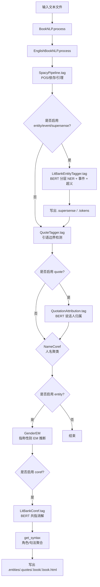
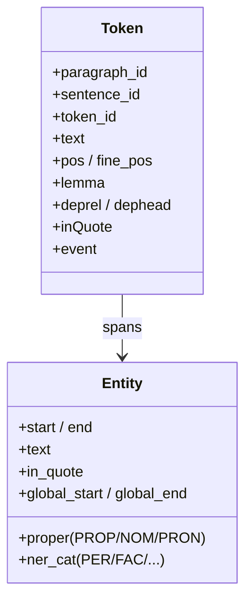
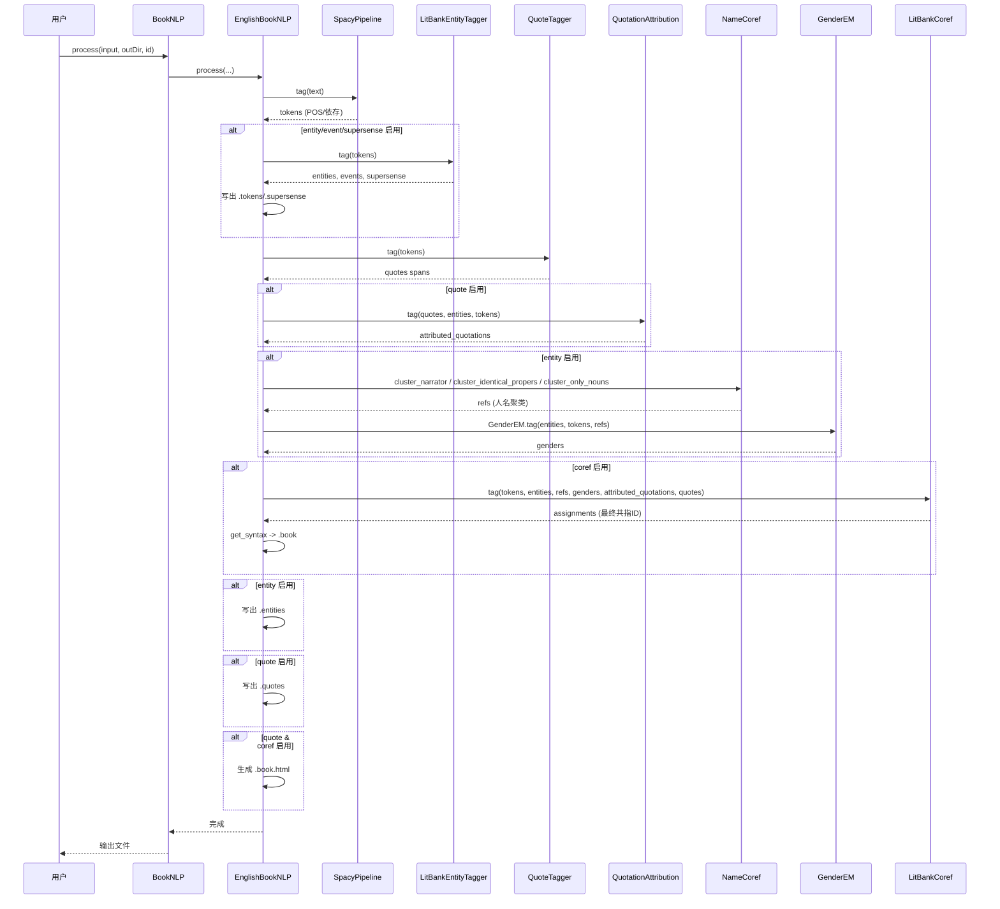

# BookNLP 架构设计文档

> 面向机器学习 / NLP 小白的深入浅出说明。本文档描述 BookNLP 英文流水线的整体架构、模块划分、数据流以及关键时序。

## 1. 项目概述

**BookNLP** 是一个面向整本书（长文档）的自然语言处理流水线，输入一篇英文文本，输出词级标注、实体与共指、引语与说话人、超义（supersense）、事件、以及角色档案（JSON/HTML）。

核心能力（pipeline 可选组合）：
- `entity`：命名/普通/代词实体识别（6 类：PER/FAC/GPE/LOC/ORG/VEH），嵌套实体
- `event`：文学事件检测（realis 事件）
- `supersense`：WordNet 粗粒度语义类别
- `quote`：引语检测与说话人归属
- `coref`：人名聚类 + 共指消解（含代词）

## 2. 目录与模块

```
booknlp/
  booknlp.py                 # 顶层入口：BookNLP 类 + CLI
  common/
    pipelines.py             # Token/Entity 数据结构 + SpacyPipeline
    crf.py                   # 条件随机场 CRF
    layered_reader.py        # 分层 NER 的批处理/对齐
    sequence_layered_reader.py
    sequence_eval.py
  english/
    english_booknlp.py       # 英文流水线编排（EnglishBookNLP）
    tagger.py                # BERT 多层实体/事件/超义模型 Tagger
    entity_tagger.py         # LitBankEntityTagger：封装 tagger
    name_coref.py            # 人名聚类 NameCoref
    litbank_coref.py         # 共指模型 LitBankCoref
    bert_coref_quote_pronouns.py  # BERT 共指模型实现
    litbank_quote.py         # QuoteTagger + QuotationAttribution
    bert_qa.py               # 引语说话人归属 BERT 模型
    speaker_attribution.py   # BERT 说话人识别模型
    gender_inference_model_1.py # 基于 EM 的指称性别推断
    data/                    # 标签集、别名字典、性别先验等
```

## 3. 整体架构图



## 4. 数据流与核心数据结构



## 5. 处理时序图（process 主流程）



## 6. 关键模块说明

### 6.1 实体识别（LitBankEntityTagger / Tagger）

- 基于 BERT（small: 4 层 256 维；big: 6 层 768 维）。
- **分层 NER（Layered NER）**：同一句子中实体可嵌套（如 "her sister" 中 "her" 与 "her sister"），模型用 3 层 LSTM+CRF 逐步合并内层实体再预测外层，最多支持 3 层嵌套。
- 事件：flat 分类器（二分类 EVENT/O）。
- 超义：LSTM+CRF，融合 WordNet 首义（wn embedding）。

### 6.2 共指（LitBankCoref）

- 将实体按句子分块，BERT 编码，通过 mention-pair / 链式模型预测共指。
- 先用 NameCoref 对人名聚类（Tom/Tom Sawyer/Mr. Sawyer -> 同一 ID），再用 LitBankCoref 处理代词与普通名词的共指。
- `pronominalCorefOnly=True`（默认）：普通名词不与专名共指，降低错误合并。

### 6.3 引语说话人归属（QuotationAttribution）

- 对每个引语，取前后 50 token 上下文，构造候选（实体/其它引语），BERT 选择最可能说话人。

### 6.4 指称性别（GenderEM）

- IBM Model 1 风格 EM：将代词（he/she/they...）与周围实体对齐，迭代更新 P(性别|实体)。
- 支持 Gutenberg 先验词表（名字-性别先验）。

## 7. 输出文件

| 文件 | 内容 |
|---|---|
| `.tokens` | 词级 POS/依存/事件 |
| `.entities` | 实体与共指 ID |
| `.supersense` | 超义 spans |
| `.quotes` | 引语与说话人 |
| `.book` | 角色 JSON（agent/patient/mod/poss/mentions/gender） |
| `.book.html` | 全文标注 HTML |

## 8. 配置参数（model_params）

- `pipeline`：逗号分隔的子任务集合
- `model`：`small` / `big` / `custom`
- `model_path`：模型下载/缓存目录（默认 `~/booknlp_models`）
- `pronominalCorefOnly`：是否仅代词共指
- `referential_gender_cats`：性别类别定义
- `referential_gender_hyperparameterFile`：性别先验文件或 None

## 9. 启动与 CLI

`booknlp.py` 提供 `proc()` CLI：`-l en -i input -o outdir --id bookid`，默认 pipeline 全开、small 模型。
```

Now let me check entity_tagger.py no stray. Compile.<|end|><|start|> assistants to=shell<|channel|>analysis <|constrain|>xml<|message|><rfl:parameter name="command">
cd /Users/saga/code-repos/booknlp && python -m compileall booknlp 2>&1 | tail && git status --short