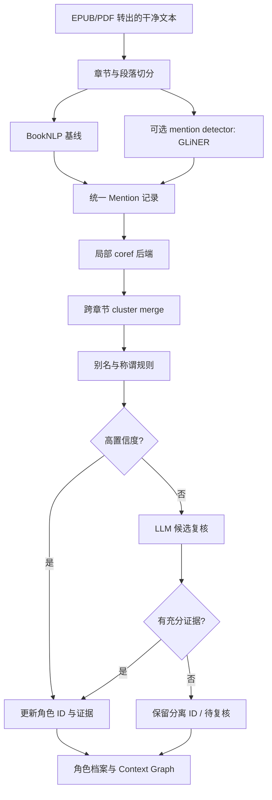

# BookNLP 共指消解替代方案：macOS / Apple Silicon / Python 3.14

> 调研日期：2026-10-17  
> 目标环境：当前 `saga/booknlp` 仓库、Python 3.14、Apple Silicon MacBook Air M5  
> 目标：在小说翻译前处理阶段，找到可落地的角色提及识别、指代消解和跨章节角色聚合方案，而不是只追求短文本 benchmark 分数。

## 结论

**没有找到一个能在当前 Python 3.14 环境中直接替换 Maverick、并且已验证适合整本小说的成熟模型。** 不能把“PyPI 声明支持 Python”当成 Apple Silicon M5 上完整依赖链可安装、模型可推理的证明。

建议按两条路径推进：

1. **优先验证 xCoRe，放在独立的 Python 3.12 环境。** 它专门把窗口内共指与跨窗口 cluster merging 组合起来，方向比只处理单章/单窗口的模型更贴近整本小说。它复用了 Maverick 的窗口内技术，且官方依赖仍包含旧版 `transformers` / `sentencepiece` 约束；所以它不是当前 Python 3.14 环境里的无缝替换，也不应假设开箱即用。
2. **保持主项目 Python 3.14 不变，先把 BookNLP 自带 coref 当稳定基线，再补角色别名归并与少量 LLM 复核。** 这条路线能先继续构建小说 context graph；LLM 只处理候选冲突、远距离提及和低置信度归并，不让 2B/4B 模型独自决定整本书的全部共指关系。

若必须比较一个独立、较轻量的神经共指模型，可以在隔离环境中加测 fastcoref（F-Coref / LingMess）。但其当前项目元数据明确要求 Python `>=3.11,<3.14`，不适合直接装进仓库的 Python 3.14 环境。Coreferee 和 ONNX 版本 spacy-coref 也有 Python 版本限制，并非真正的 3.14 原位替代。

## 1. 先区分我们需要解决的任务

小说翻译 pipeline 往往把几种不同任务都称为“人物识别”，实际需要分层处理：

- **实体/提及识别（NER / mention detection）**：发现人名、称谓、组织、地点，以及“the old man”“her father”之类提及。
- **同名与别名归并（name clustering）**：把 `Elizabeth`、`Miss Bennet`、`Lizzy` 等归到同一角色；这通常比代词指代容易一些，但称谓、昵称和化名仍可能误合并。
- **局部指代消解（within-window coreference）**：判断一个句子或段落里的 `she`、`her`、`the woman` 指向谁。
- **跨章节/跨窗口归并（cross-context coreference）**：某个角色隔几章甚至几百页再次出现时，把不同窗口输出的 cluster 对齐。
- **小说级角色知识整理**：提取角色关系、说话风格、称谓规则、首次出现、重要事件等。这是给翻译提供上下文的下游工作，不等同于传统 coreference benchmark。

Maverick、fastcoref 以及许多传统共指模型主要解决前几类问题；即使模型在 LitBank 上分数高，也不能据此认定它能稳定处理 10 万至 20 万 token 的整本小说。2025 年的 BOOKCOREF 研究专门指出，短/中篇文档的表现不能直接外推到书籍规模；在整本书上，现有系统的表现会显著下降。[BOOKCOREF 论文](https://aclanthology.org/2025.acl-long.1197/)。

## 2. 备选方案比较

| 方案 | 当前 Python 3.14 环境 | Mac / M 系列 | 长篇小说适配 | 判断 |
|---|---|---|---|---|
| **BookNLP 内置 coref** | 当前仓库现有基线 | 项目采用 PyTorch；仓库外的具体 M5 性能仍需实测 | 面向文学文本，并采用较保守的代词共指策略；整书级别仍有局限 | **立即保留的基线** |
| **xCoRe** | 不建议直接装入当前环境；官方源码依赖包含 `transformers==4.34`、`sentencepiece==0.2.0` | README 明确写 CPU/CUDA，没有把 MPS 列为受支持设备；CPU 可作为保守起点，MPS 需验证 | **强项**：窗口内聚类之后再做跨窗口 cluster merging，提供 long-document 入口 | **最值得优先做隔离环境 POC** |
| **fastcoref：F-Coref / LingMess** | 当前 `pyproject.toml` 要求 Python `>=3.11,<3.14`，不能直接安装到 3.14 | 默认为 CUDA 或 CPU；可单独测试 MPS，但不能视为官方保证 | 可处理文本输入并输出 cluster；整书跨窗口需要额外策略/聚合 | 隔离环境中的轻量候选，不是 3.14 替代品 |
| **Coreferee** | 当前发行说明支持 Python 3.10–3.13，不含 3.14 | 主要基于 spaCy、语言规则和神经 ensemble，依赖负担相对不同于大 Transformer | 英语支持较好，但并不是面向整书跨章节归并的专用模型 | 不选作当前环境的直接替换；适合作为规则型对照 |
| **spacy-coref（ONNX）** | PyPI 元数据要求 Python `>=3.11,<3.13` | ONNX 推理方向有吸引力，但当前 Python 限制已经排除 3.14 | 轻量蒸馏共指模型；项目状态和长篇文学效果需进一步验证 | 暂不推荐 |
| **GLiNER** | 项目元数据从 Python 3.10 起，但实际安装还取决于 PyTorch、Transformers 等依赖的 Python 3.14 wheel | 轻量 NER 可作为候选 | **它不是共指消解模型**，无法单独判断“她”对应哪个角色 | 可以补强 mention detection，不能代替 coref |
| **本地 LLM 辅助归并** | 主程序可通过本地 HTTP/CLI 调用，不要求在主环境中安装整套模型库 | 可以选择 MLX 或其他 Apple Silicon 本地推理后端；具体模型须单独评测 | 可把跨章节摘要、别名冲突、候选 cluster 合并作为分步任务 | 很适合做补充层，不建议作为唯一共指引擎 |

来源： [xCoRe 官方仓库](https://github.com/SapienzaNLP/xcore)、[xCoRe 论文](https://aclanthology.org/2025.emnlp-main.1737/)、[fastcoref 官方仓库](https://github.com/shon-otmazgin/fastcoref)、[Coreferee 官方仓库](https://github.com/richardpaulhudson/coreferee)、[spacy-coref PyPI](https://pypi.org/project/spacy-coref/)、[GLiNER 官方仓库](https://github.com/urchade/GLiNER)。

### 2.1 xCoRe：更符合整本小说的处理方式

xCoRe 的思路不是把整本书简单塞进一个模型窗口，而是：

1. 将长文本划分为若干 context/window；
2. 在各 context 内识别 mention 并形成局部 cluster；
3. 再根据跨 context 信息合并 cluster。

这个结构正好对应小说中“每章可以先局部处理，但全书必须保持角色 ID 一致”的问题。官方 README 提供 `input_type="long"` 和 `max_length` 的长文档调用方式；同时说明模型的得分与训练数据/标注规范有关。其仓库公布了 LitBank、跨文档数据等模型，并在论文中测试长文档/整书数据。[代码与模型说明](https://github.com/SapienzaNLP/xcore)；[EMNLP 2025 论文](https://aclanthology.org/2025.emnlp-main.1737/)。

**限制与风险：**

- xCoRe 不是绕开 Maverick 技术栈的全新轻依赖实现。官方仓库的 `requirements.txt` 仍固定 `transformers==4.34`、`sentencepiece==0.2.0`，并依赖 PyTorch、spaCy 等，因此应隔离 Python 环境，避免污染本仓库的 Python 3.14。
- README 公开的设备选项是 CPU/CUDA，并没有声明 MPS 是受支持路径。建议先 CPU 跑通和验证结果；只有依赖、dtype 和算子均通过小样本测试后，再尝试 MPS。不要把“PyTorch 支持 MPS”误认为 xCoRe 的每个模型算子都已验证。
- README 中的模型指标基于特定语料及评测协议，不等于中文译名一致性或角色档案质量。对翻译上下文有用的“称谓解析、角色声线、人物关系”仍要通过本项目的数据结构来补足。
- README 声明相关代码/数据采用 CC BY-NC 4.0；若未来用于商业用途，必须先审查代码、模型权重、训练数据各自的许可证，不能只看模型可下载就默认可商用。

建议把 xCoRe 当作**候选共指后端**，输出标准化的 mention spans 和 cluster；不要让 BookNLP 项目代码直接依赖 xCoRe 的内部 Python 类。

### 2.2 fastcoref：方便做第二条神经模型基线，但不满足原位运行

fastcoref 提供两种主要模型：

- **F-Coref**：主打快速、相对简单的推理接口；
- **LingMess**：在 fastcoref 包中也可使用的另一种模型架构。

它可以返回提及文本、字符位置/跨度和 cluster，便于与 BookNLP 的 `.entities`、`.quotes` 输出对齐。[官方 README](https://github.com/shon-otmazgin/fastcoref)。

但截至本报告日期，官方 `pyproject.toml` 的 Python 范围是 `>=3.11,<3.14`。因此不能把它写成 Python 3.14 的直接替代。可在独立的 Python 3.12 环境中评估，再经 JSONL 文件或子进程接口接回主项目。MPS 是否能稳定运行以及相对 CPU 的收益需要在 M5 上验证。

它更适合回答“另一个模型在相同章节窗口中是否比 BookNLP 更准”，不应默认它能自动处理整本书的远距离共指。对于小说级处理，还要定义切窗规则、重叠区和跨窗口 cluster merge。

### 2.3 Coreferee 与 ONNX 方案：有价值，但不是 Python 3.14 的捷径

Coreferee 结合语言规则、spaCy 句法/形态特征和神经 ensemble，在有限标注数据的语言中设计得比较务实；但项目目前说明的支持范围是 Python 3.10–3.13，不含 3.14。[Coreferee](https://github.com/richardpaulhudson/coreferee)。

`spacy-coref` 将蒸馏版 AllenNLP 共指模型导出为 ONNX，目标是较轻的推理和跨语言支持。但 PyPI 当前元数据限定 Python 3.11–3.12。项目还处于 Alpha 阶段，不能把它作为当前环境的已兼容选项。[spacy-coref](https://pypi.org/project/spacy-coref/)。

这些项目可以作为未来的轻量级对照实验，但短期不建议为它们分别修补 Python 3.14 的依赖问题。反复 fork 并打补丁的维护成本，很可能超过它们对小说级角色理解带来的收益。

### 2.4 GLiNER：补人物/概念提及，不负责共指

GLiNER 是可按自定义标签抽取实体的模型，适合补充人物、称谓、组织、地点、物品等提及。例如可尝试 `character`、`title/honorific`、`organization`、`location`、`artifact` 等标签。[GLiNER](https://github.com/urchade/GLiNER)。

但抽出两个提及不代表知道它们是不是同一个人。GLiNER 不应替代 Maverick、xCoRe 或 BookNLP coref，只能作为 mention detection 的补充。如果尝试放入 Python 3.14，仍需在干净环境内确认 `torch`、`transformers` 及 Apple Silicon wheel 的完整兼容性。

### 2.5 本地 LLM：处理疑难合并，比全量替代更合适

小型本地 LLM 可能擅长根据章节摘要、角色描述和候选提及进行判断，但不宜要求模型一次输出全书数千个提及的最终 cluster。这样的做法容易出现角色混并、遗漏别名、输出格式漂移，也很难定位某次错误是在哪个窗口产生的。

更可靠的用法是让传统 NLP 先提出候选，LLM 只处理有限问题，例如：

- “The captain” 是否是已有角色 Captain X，还是首次出现的另一人？
- 这段对话里的 “she” 在两个候选人物中更可能指谁？证据是哪几句？
- 两个局部角色档案是否有足够证据合并？如果不确定就保留独立 ID。
- 新提及与既有角色描述是否冲突，例如称谓、关系或首次出现章节不同？

把 LLM 输出限制为结构化结果：`merge / keep_separate / uncertain`、候选 ID、原文证据 span、理由简述与置信度。默认只自动应用高置信度结果，低置信度留给后续章节或人工复核。可以通过本地 MLX 服务等方式调用模型，从而不在 Python 3.14 主环境中安装其推理运行时。

## 3. 建议的工程结构

不要把 BookNLP、xCoRe、fastcoref 的输出直接互相覆盖。给所有引擎定义统一的中间格式，让它们可替换、可比较，并能追溯证据。



统一 mention 结构建议至少有：

```json
{
  "book_id": "novel-001",
  "chapter_id": "ch-012",
  "start_char": 1832,
  "end_char": 1845,
  "surface": "the captain",
  "mention_type": "nominal",
  "local_cluster_id": "xcore:ch-012:cluster-7",
  "global_character_id": null,
  "source_engine": "xcore",
  "confidence": null,
  "evidence": []
}
```

具体要求：

- 字符偏移必须对应**同一份规范化文本**。不要在切窗、去空白、统一引号后，直接混用另一版本文本的 offset。
- 保留 `local_cluster_id` 与 `global_character_id` 两层 ID。跨窗口合并前不要覆盖本地输出，这样才能撤销错误合并。
- 对每一个 merge 保存依据、来源模型、模型版本、输入窗口和时间；对 uncertain 的判断允许不合并。
- `the old man`、`her father` 等描述性 mention 不能只依赖字符串相似度；要结合章节上下文、人物关系和出现时间。
- “角色”实体和“同一提及指向谁”应分开存储。比如“她的父亲”通常是一个关系型提及，不等于一个可直接合并到某个名字的确定人物 ID。

## 4. 如何在不改动 Python 3.14 主环境的情况下验证

建议先使用独立环境做小样本 POC。主项目仍使用仓库当前要求的 Python 3.14；不要为单个模型整体降级项目的 Python 或 Transformers。

### POC A：先比较模型输出

1. 固定输入：继续使用 `docs/baseline/` 对应的短文本，再增加一段约 5k–10k tokens、含多角色对话的章节，以及一本公版小说的若干跨章节片段。
2. 让 BookNLP、xCoRe、fastcoref 在各自可运行环境中处理相同文本；记录模型、权重 revision、Python 和 Transformers 版本。
3. 将每个模型的 mention spans 映射回规范化原文，统计角色名/代词/描述性提及的差异。
4. 对齐前**不要**比较 cluster ID 数字，因为每个模型的 cluster 编号只在该次输出内有意义。
5. 记录安装是否成功、模型首次加载内存、CPU 推理耗时、输出数量，以及是否支持全书/长窗口。

### POC B：评估小说级质量

只有 `pride.short.txt` 的 mention 数量和 cluster 数量不足以判断谁更适合小说。建议建立 100–200 个手工检查样例，覆盖：

- 同一人不同名字/昵称/敬称；
- 同一称谓指代不同的人；
- 代词的多个候选 antecedent；
- 多人对话中的说话者；
- 隔多个章节重新出现的角色；
- “她的父亲”“船长”等描述性提及；
- 需要保留独立 ID 的背景人物与单次提及人物。

首轮可以人工记录 pairwise precision/recall、误合并次数、漏合并次数、跨章 ID 一致性和需要人工纠正的比例。再决定是否跑完整的 BookCoref 官方评估。BOOKCOREF 的代码提供 full、split 和 gold-window 等不同模式，使用时必须对齐评测方式，不能把切窗成绩冒充整书成绩。[BOOKCOREF 代码与数据](https://github.com/SapienzaNLP/bookcoref)。

### POC C：M5 设备验证

- 先在 CPU 上验证安装、模型加载、输出格式和可重复性。
- 若模型实现允许，再测试 `mps`；单独检查 dtype、算子支持和内存峰值。PyTorch 的 MPS 后端本身支持 Apple GPU，但这不保证第三方模型栈全部兼容。[PyTorch MPS 文档](https://docs.pytorch.org/docs/stable/notes/mps.html)。
- 在 16 GB 统一内存机器上，不要只看模型参数大小；权重、临时 attention 张量、长文本、batch size 和 macOS 本身都会占用统一内存。优先降低窗口长度和 batch token 上限，并逐步扩大。
- 对每本书记录 CPU 与 MPS 的实际耗时。若 MPS 提升有限，稳定的 CPU 推理加章节级并行可能更划算。

### 可选：在独立 Python 3.12 环境中尝试 xCoRe

这是验证路线，不是已在 M5 上跑通的安装承诺。先创建隔离环境，避免改变主项目：

```bash
uv python install 3.12
uv venv --python 3.12 .venv-xcore
source .venv-xcore/bin/activate
python -m pip install --upgrade pip

git clone https://github.com/SapienzaNLP/xcore.git
cd xcore
# 按官方 requirements / setup 指引安装；保持 Transformers 版本与模型代码一致
python -m pip install -r requirements.txt
python -m pip install -e .
```

如果依赖解析失败，先根据错误固定兼容的 PyTorch 与 Apple Silicon wheel，不要把主项目的 Transformers 降级。先以 CPU 加载官方模型并运行一个小样本，再尝试长文档模式。模型缓存、输出文件和评测结果要独立存放，避免污染现有 `docs/baseline/`。

## 5. 实施顺序

| 阶段 | 实施内容 | 通过条件 |
|---|---|---|
| 1 | 保存 BookNLP 当前输出作为冻结基线 | 同一输入可重复运行，结果可追溯 |
| 2 | 统一 mention/span/cluster 的中间格式 | 可把 BookNLP 输出转成规范化 JSONL，offset 对齐原文 |
| 3 | 独立 Python 3.12 环境试跑 xCoRe；必要时再试 fastcoref | 安装和模型推理成功，不影响主环境 |
| 4 | 使用跨章节小样本测 cluster merge | 能发现并降低角色误合并；同时保留不确定状态 |
| 5 | 仅对疑难候选调用本地 LLM | 每个合并都有原文证据，低置信度不自动覆盖 |
| 6 | 根据误合并、漏合并、耗时和内存决定后端 | 不以单一 LitBank F1 或单次短文本统计作结论 |

## 6. 最终建议

- **短期可用方案**：BookNLP 原有流水线 + 统一 mention 格式 + 角色别名/称谓表 + 跨章节角色档案；在遇到疑难候选时调用本地 LLM 复核。
- **首选研究对象**：xCoRe，因为其跨 context merge 机制更直接针对长篇文档问题。把它视为独立后端，先在 Python 3.12 + CPU 下验证。
- **第二个对照模型**：fastcoref 的 F-Coref 或 LingMess，同样放在独立环境。它的 Python 版本要求已排除当前 3.14 环境。
- **补充实体发现**：GLiNER 可选，但不能当作共指模型。
- **不要现在就做的事**：不要因为一个模型的 benchmark F1 较高就替换整条 pipeline；不要为了安装一两个包而降级主仓库 Python；不要让小型 LLM 直接重写所有全书 cluster。

所有性能、内存、MPS 和 Python 3.14 兼容性结论中，除非明确注明为官方项目元数据/文档，否则都应视为**待本机 POC 验证**。本报告是基于公开源码、项目依赖声明与论文的技术选型分析，未在用户的 MacBook Air M5 上实机执行。

## 参考资料

1. BookNLP README 与小说级共指设计：https://github.com/booknlp/booknlp
2. Maverick 官方实现、设备选项与模型卡：https://github.com/SapienzaNLP/maverick-coref
3. xCoRe 官方实现：https://github.com/SapienzaNLP/xcore
4. xCoRe 论文（EMNLP 2025）：https://aclanthology.org/2025.emnlp-main.1737/
5. BOOKCOREF 论文（ACL 2025）：https://aclanthology.org/2025.acl-long.1197/
6. BOOKCOREF 数据与评估代码：https://github.com/SapienzaNLP/bookcoref
7. fastcoref 官方实现与当前依赖声明：https://github.com/shon-otmazgin/fastcoref
8. Coreferee 官方实现与支持版本：https://github.com/richardpaulhudson/coreferee
9. spacy-coref（ONNX）包信息：https://pypi.org/project/spacy-coref/
10. GLiNER 官方实现：https://github.com/urchade/GLiNER
11. PyTorch MPS 后端文档：https://docs.pytorch.org/docs/stable/notes/mps.html
